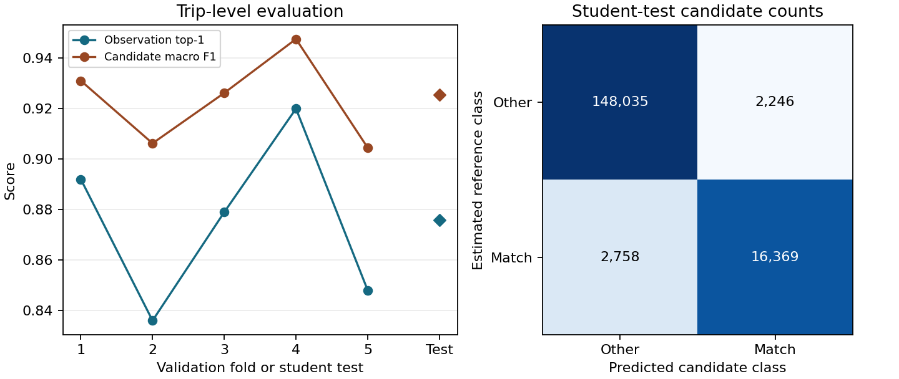

# Distance-weighted KNN for PathSnap

The [KNN sequence decoder](sequence/README.md) improved student-test road-selection accuracy from **87.57% to 96.26%**. The figures below describe the original pointwise KNN used to score each candidate.

On the ten student-test trips, KNN selected the estimated reference arc for **16,755 of 19,133 eligible observations (87.57%)**. The distance-plus-heading rule scored 83.92% on the same laptop rebuild. Both use the shared candidate search, labels and observation-level evaluator from commit `269405e`.

| Metric | Five-fold validation mean | Student test |
| --- | ---: | ---: |
| Observation top-1 | 87.49% | 87.57% |
| Candidate macro F1 | 0.9231 | 0.9254 |
| Candidate log loss | 0.0987 | 0.0870 |

## How it works

The candidate generator asks which physical roads are near a GPS point. KNN asks a different question about **each candidate row**: which previously labelled examples had similar distance, direction, motion and road-network features? Those examples vote on whether the candidate matches. The highest score among the current point's candidates selects its predicted arc.

1. Read the local 37-feature Parquet tables using the team's loader. Use rows with `label_ok == 1`. Keep each training trip in its assigned validation fold.
2. Fit a standard scaler on the fitting rows. Metres, seconds, degrees and counts have different units. Scaling keeps a change of one standard deviation comparable before measuring similarity.
3. Fit principal component analysis (PCA) on those same rows and retain eight components. Use Euclidean distance in this space, with no whitening. The final projection retains 67.68% of the standardized training variance. This makes neighbor lookup practical on the laptop while retaining every eligible training example. Discarded components can contain information that would distinguish two candidates.
4. For each query, use an exact KD-tree search in the eight-dimensional space to retrieve 25 neighbors. Each vote has weight equal to the shared training-trip weight divided by neighbor distance. If any retrieved neighbors have distance zero, only exact matches vote, using their trip weights.
5. Convert the weighted positive fraction `p` to a score `(25*p + 0.5)/26`. This adds half a vote per class so unanimous neighborhoods give finite binary log loss. These are smoothed vote shares. Calibration on a separate dataset is untested.

KNN stores examples and has no gradient-based training loss or epochs. Its fit learns the scaling and projection and builds the search index. We fixed the neighbor count and component count before evaluating student-test labels. This run is an initial model comparison; Bayesian tuning is a later experiment.

## Results and limitations

- **Generalisation.** Validation top-1 ranged from 83.59% to 92.00%, with a sample standard deviation of 3.39 percentage points. Student-test trip 00000077 was the weakest at 72.28% (2,827 of 3,911). A single pooled number hides this trip variation.
- **Candidate classification.** At the shared 0.5 threshold, student-test accuracy was 97.05%, macro precision 0.9305, macro recall 0.9204, and positive-class F1 0.8674 across 169,408 candidate rows. Observation top-1 measures the actual road selection. Its denominator includes six eligible points whose reference arc was absent from the candidate set. Another 27 points had unreliable references and were excluded under the shared evaluator.
- **Route continuity.** Among changes of predicted arc within a GPS segment, 76.78% were connected within one network hop and 87.43% within two. These are independent KNN selections before HMM/Viterbi decoding.
- **Cost.** The final fit on 1,479,905 rows from 80 trips took 3.20 s. Scoring took 101.81 ms per 1,000 candidate rows on the laptop, excluding raw feature generation and model loading. The saved model is 42.30 MiB and includes the scaler, projection, projected training examples, labels and trip weights. Loading rebuilds the search tree.



[Full metrics and environment](metrics.json) · [Five individual folds](cv_folds.csv) · [Ten student trips](student_trips.csv) · [Download the example Folium map and open it in a browser](trip_00000052.html)

## Run on a local checkout

From the repository root, use Python 3.12 and the versions in this directory. Training reads the shared local files under `data/processed`. For a fresh checkout, rebuild those files once with `scripts/02_build_features.py --data-root "data/raw/Student folder"`. The raw directory contains the extracted `train` and `student_test` subdirectories.

```powershell
python -m pip install -r models/distance_weighted_knn/requirements.txt
python models/distance_weighted_knn/train.py --data-root "data/raw/Student folder"
python models/distance_weighted_knn/figures.py --data-root "data/raw/Student folder"
```

The training script refits preprocessing inside each of the five training folds, then fits the final pipeline on all 80 training trips. The figures script also runs inference on raw student trip 00000052 with its reference route withheld until scoring is complete. Its predicted segments matched the estimated reference at 249 of 262 observations.

```python
import joblib
from pathsnap.dataset import FEATURES

model = joblib.load("models/distance_weighted_knn/model.joblib")
# candidates is the team's candidate DataFrame for the trip being processed.
candidates["knn_score"] = model.predict_proba(candidates[FEATURES])[:, 1]
best = candidates.loc[candidates.groupby(["trip_id", "point_idx"]).knn_score.idxmax()]
```

[Training and evaluation source](train.py) · [Neighbor search and scoring source](../../pathsnap/knn.py) · [Plot and map source](figures.py)
