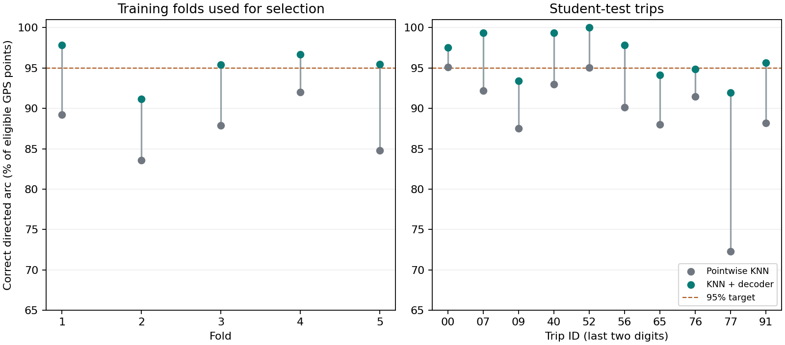

# Route decoding for distance-weighted KNN

This page records the first decoder. The second iteration reached **97.22%** on the same student-test split by guiding road choices with more widely spaced GPS readings. [Second iteration and prediction command](iteration2/README.md)

The decoder reached **96.26% road-selection accuracy** across the ten student-test trips. It matched the estimated reference arc at **18,417 of 19,133 eligible observations**, improving on pointwise KNN by **1,662 correct matches**. All ten trips improved. The weakest was trip 00000077 at 91.95% (3,596 of 3,911). The 95% target applies to the pooled score.

| Measure | Pointwise KNN | KNN with route decoding |
| --- | ---: | ---: |
| Mean top-1 across five training folds used for selection | 87.49% | 95.32% |
| Student-test observation top-1 | 87.57% | 96.26% |
| Student-test transitions connected within one hop | 76.78% | 89.12% |
| Student-test transitions connected within two hops | 87.43% | 97.68% |

The denominator includes candidate misses and excludes 27 GPS points with unreliable reference labels. Route continuity uses changes of predicted arc within a trajectory segment under the shared evaluator. Preparing and decoding the ten candidate sequences took 4.30 seconds on the laptop, excluding raw preprocessing, loading and KNN scoring. The final evaluator trips have yet to be scored.



The hidden state at each GPS reading is a candidate directed arc. KNN assigns a score to each candidate independently. This decoder uses that score, the GPS-to-road distance and possible travel between consecutive arcs to choose the route. It works offline on a complete trip.

## Prediction

From the repository root, with the baseline model and its dependencies installed, run:

```powershell
python models/distance_weighted_knn/sequence/predict.py "data/raw/Student folder/student_test/00000052" "outputs/knn_route_52.csv"
```

The output has one row per GPS reading, its timestamp, original row number, trajectory segment, and predicted arc ID. A value of −1 means the candidate search returned no road for that observation. Prediction loads the GPS track and road graph with reference-route loading disabled.

## What changes the road choice

1. The emission score combines the log of the KNN vote share with a penalty for distance from the GPS reading. The low-speed option reduces the influence of individual readings when motion over the local window is small.
2. For different arcs, the transition accounts for the remaining distance on the first arc, the shortest directed connection between the endpoints, and the distance travelled along the next arc. For the same arc, it uses signed progress. Travel that disagrees with the GPS displacement incurs a penalty. The search considers connecting paths up to 500 m and uses a finite fallback cost for implausible or unavailable connections. Direct reversals and changes of arc have separate penalties.
3. Viterbi accumulates emission scores minus transition penalties and backtracks to recover the best sequence. It restarts at preprocessing gap boundaries and after observations with no candidates.
4. An optional second pass estimates when the vehicle crossed from one arc to the next. It aligns observations monotonically to the predicted arc sequence by minimizing GPS-to-segment distance, considering positions within three route entries of the first-pass assignment. Shortest-path connectors can supply intermediate arcs. Each final prediction must still belong to that observation's original candidate set.

## Selection and reproduction

Each of the 80 training trips received KNN scores from a model fitted on the other four folds. The decoder saw all candidate observations, including those with unreliable labels. Reference information was used to score completed predictions. The objective was the unweighted mean of the five fold-level observation top-1 scores. Within each fold, every eligible GPS point counted once, including candidate misses.

The 38 configurations were explored in stages using training-fold results. Those fold scores describe model selection and can be optimistic. After fixing the winning settings, the final evaluation used the existing 80-trip KNN model on the ten student-test trips. Candidate probabilities and their binary classification metrics belong to the original KNN. The decoder changes the selected arc sequence.

```powershell
python models/distance_weighted_knn/sequence/oof.py
python models/distance_weighted_knn/sequence/evaluate.py select --data-root "data/raw/Student folder"
python models/distance_weighted_knn/sequence/evaluate.py test --data-root "data/raw/Student folder"
python models/distance_weighted_knn/sequence/plot_results.py
```

[Selected settings](settings.json) · [All trials](trials.csv) · [Validation folds](validation_folds.csv) · [Training trip results](validation_trips.csv) · [Student-test metrics](student_metrics.json) · [Student-test trips](student_trips.csv) · [Decoder implementation](../../../pathsnap/knn_sequence.py)
