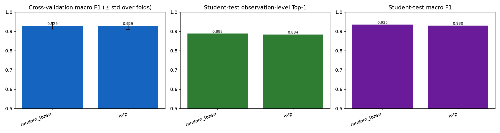
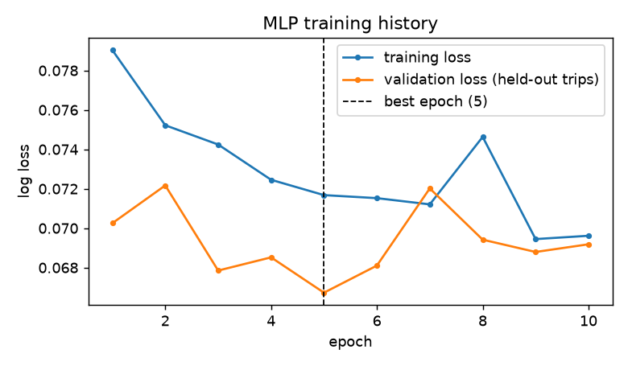
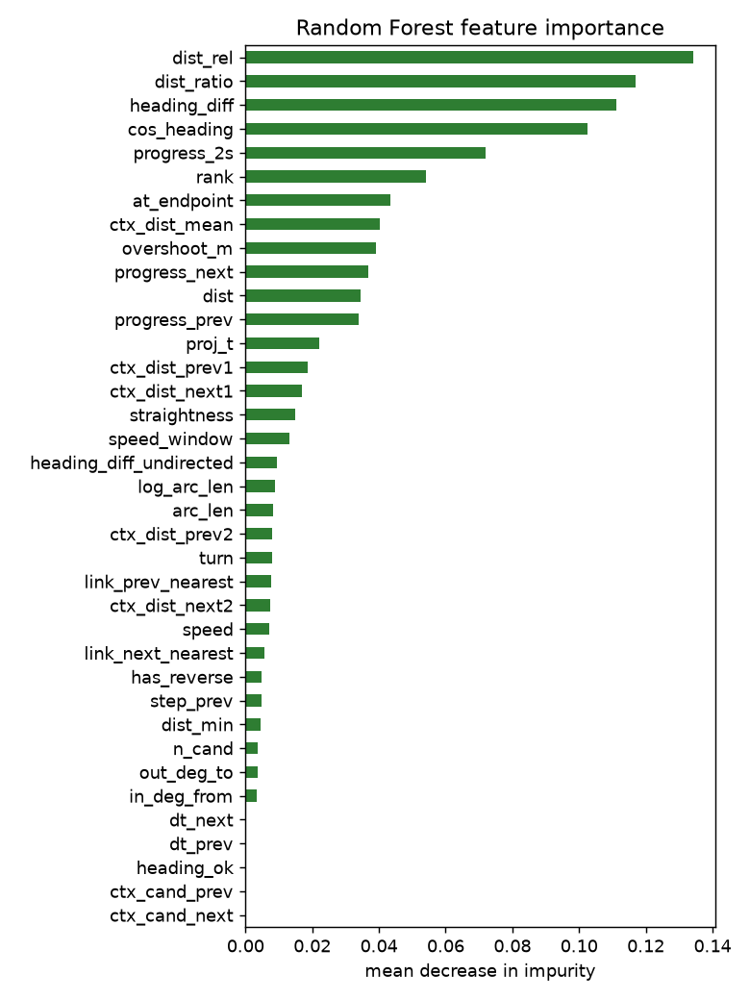

# PathSnap: Random Forest and MLP results (report sections 3.1 to 3.3)

> **Draft for the team report.** Every number below comes from files in this repository (see "Where each number comes from"). The explanations are a starting point. Rewrite them in your own words before you submit, because the report is checked for AI-generated text and every member must be able to explain it in the viva.
>
> Bayesian hyperparameter optimisation (section 4) is done on the team's selected model by the teammate who owns it, so it is not included here.

**Data and protocol (same for every team model):** the shared candidate table in `data/processed/` (37 location-independent features per GPS observation × candidate road segment, label 1 = reference segment). Training and CV use the 80 training trips with the shared trip-level 5 folds (`folds.csv`, seed 42). Comparison uses the 10 student-testing trips. Evaluator trips are not used anywhere. Only labelled observations (`label_ok == 1`) are used, and rows are weighted by `trip_weight`. All metrics come from `pathsnap/evaluate.py`.

---

## 3.1 Overall model comparison (our two rows)

| Model | Algorithm family | Key configuration | CV macro F1 | Top-1 accuracy (student-test) | Route continuity 1-hop / 2-hop | Student-test macro F1 | Log loss | Inference time (ms / 1000 candidates) |
|---|---|---|---|---|---|---|---|---|
| Random Forest | Ensemble (bagging) | 100 trees, max_depth 20, min_samples_leaf 5, max_features sqrt, 60k fit rows per fold | 0.9289 ± 0.0180 | 88.85% | 77.01% / 87.01% | 0.9351 | 0.0629 | 2.70 |
| MLP | Neural network | 37→64→32→1, ReLU, Adam lr 1e-3, L2 α 1e-4, batch 512, early stopping (patience 5), 80k fit rows per fold | 0.9293 ± 0.0195 | 88.41% | 80.32% / 89.44% | 0.9300 | 0.0656 | 1.02 |

Route continuity here is the **classifier-only** Top-1 route (no HMM). For scale, the reference labels themselves are 90.8% / 98.5% continuous on student-test.

### Full metric list (team-standard format)

Source: `results/model_comparison/metrics_summary.csv` (regenerate with `python evaluation/export_metrics.py random_forest mlp`).

| Metric | Random Forest | MLP |
|---|---|---|
| CV Top-1 Accuracy | 88.02% | 88.33% |
| CV Macro F1 | 92.89% | 92.93% |
| Student-test Top-1 Accuracy | 88.85% | 88.41% |
| Student-test Macro F1 | 93.51% | 93.00% |
| Student-test Log Loss | 0.0629 | 0.0656 |
| Route Continuity, 1-hop | 77.01% | 80.32% |
| Route Continuity, 2-hop | 87.01% | 89.44% |
| Candidate Miss Rate | 0.031% | 0.031% |
| Candidate-row Accuracy | 97.46% | 97.22% |
| Macro Precision | 94.50% | 93.36% |
| Macro Recall | 92.59% | 92.65% |
| Positive-class F1 | 88.46% | 87.57% |
| Positive-class Precision | 90.73% | 88.40% |
| Positive-class Recall | 86.30% | 86.76% |
| CV Top-1 std over 5 folds | 3.21% | 3.42% |
| Train Top-1 (overfitting check) | 90.85% | 90.27% |
| Training time, final refit (s) | 25.5 | 25.0 |
| Inference (ms / 1000 candidate rows) | 2.70 | 1.02 |

The candidate miss rate is a property of the shared candidate generator, not of the model, so it is identical for every model (0.031% of labelled student-test observations have no reference segment within 50 m).

**Primary metric note:** observation-level Top-1 accuracy is the metric that matches the task (one road segment per GPS point). Candidate-row accuracy (about 97%) is much higher only because most candidate rows are easy negatives (88% of rows are label 0), so it should not be quoted as "the accuracy".

### Per-fold CV results (Top-1 on the validation fold)

| Fold | RF val Top-1 | RF train Top-1 | MLP val Top-1 | MLP train Top-1 |
|---|---|---|---|---|
| 0 | 89.34% | 93.73% | 89.89% | 92.90% |
| 1 | 84.11% | 92.18% | 83.95% | 91.64% |
| 2 | 88.61% | 90.67% | 88.92% | 90.70% |
| 3 | 92.33% | 86.66% | 92.78% | 85.30% |
| 4 | 85.73% | 90.98% | 86.09% | 90.81% |

Source: `models/random_forest/cv_folds.csv`, `models/mlp/cv_folds.csv`.

---

## 3.2 Per-model questions

### Model: Random Forest

**A. Model understanding**

1. *Why suitable:* candidate scoring depends on non-linear interactions. A small distance matters only if the heading agrees, and heading is meaningless when the vehicle is stopped (low `speed_window`, low `straightness`). Trees learn these threshold rules directly. The features are in mixed units (metres, degrees, counts), and trees need no scaling. Averaging many trees gives probability estimates that feed the HMM as emission scores.
2. *Strengths and limitations seen in our runs:*
   - Strength: best probability quality of our two models (student-test log loss 0.0629 vs 0.0656), and the best Top-1 (88.85%) and macro F1 (0.9351) on student-test.
   - Strength: feature importances are easy to inspect. Top features: `dist_rel` 0.134, `dist_ratio` 0.117, `heading_diff` 0.111, `cos_heading` 0.102, `progress_2s` 0.072 (`models/random_forest/feature_importance.csv`). The model relies mostly on relative distance and heading agreement, as expected.
   - Limitation: it scores each candidate independently, so it cannot resolve ambiguities that need the sequence. See the error analysis below: 45% of its errors are the opposite-direction arc of the same street.
   - Limitation: the largest model file (9.7 MB) and the slowest inference of the two (2.70 ms per 1000 candidates), though still far below what the API needs.

**B. Training and configuration**

5. *Hyperparameters (initial values):* `n_estimators=100`, `max_depth=20` (limits overfitting and file size), `min_samples_leaf=5`, `max_features="sqrt"`, `random_state=42`. Trained on 60,000 randomly sampled rows per training fold (about 300k rows, every trip kept). Validation folds and student-test are always scored in full.
6. *Objective:* each tree is grown by minimising Gini impurity on the binary label, with rows weighted by `trip_weight` so that each trip contributes equally.

**C. Experimental results**

7. *Student-test performance:* Top-1 88.85%, macro F1 0.9351, macro precision 0.9450, macro recall 0.9259, candidate-row accuracy 97.46%.
8. *Top-1 / macro F1 / log loss on student-test:* 88.85% / 0.9351 / 0.0629.
9. *Over- or underfitting:* mild overfitting at most. Mean train Top-1 is 90.85% vs mean CV Top-1 88.02%, a 2.8-point gap. The gap varies by fold, and in fold 3 validation is higher than training (92.3% vs 86.7%), so most of the variation comes from how hard the trips in each fold are, not from memorisation. Fold-to-fold std is 3.2 points, with fold 1 the hardest (84.1%). `max_depth=20` and `min_samples_leaf=5` keep the trees from fitting individual noisy points. The ceiling is not underfitting in the usual sense either: the correct segment is ranked first or second for 96.3% of observations (see error analysis), so the remaining errors need sequence information.

Confusion matrix (student-test, threshold 0.5, candidate rows): TN 148,594 · FP 1,687 · FN 2,621 · TP 16,506.

### Model: MLP (multi-layer perceptron)

**A. Model understanding**

1. *Why suitable:* a neural network learns smooth non-linear combinations of the 37 features, for example how much the heading difference should count depending on speed and distance. It outputs a probability through a sigmoid trained on log loss, which is what the HMM emission model needs. It is also cheap at inference time.
2. *Strengths and limitations seen in our runs:*
   - Strength: the fastest inference (1.02 ms per 1000 candidates, 2.6× faster than RF) and a tiny model file (144 KB).
   - Strength: the highest CV Top-1 (88.33%) and the best classifier-only route continuity (80.32% 1-hop, 89.44% 2-hop). Its Top-1 choices jump between unconnected segments less often than RF's.
   - Limitation: it needs feature standardisation (a `StandardScaler` fitted on training rows only, stored inside the model), and its result depends on the random seed and the early-stopping split.
   - Limitation: slightly worse calibrated probabilities than RF (log loss 0.0656 vs 0.0629) and a slightly lower student-test Top-1 (88.41%).

**B. Training and configuration**

5. *Hyperparameters (initial values):* hidden layers (64, 32), ReLU, Adam with `learning_rate_init=1e-3`, L2 penalty `alpha=1e-4`, `batch_size=512`, up to 60 epochs with early stopping (`patience=5` on validation log loss). Early-stopping validation set: 10% of the *training* trips (never the CV validation fold or student-test). Trained on 80,000 sampled rows per training fold (about 400k rows).
6. *Loss:* binary cross-entropy (log loss) plus the L2 penalty, minimised by Adam.

**C. Experimental results**

7. *Student-test performance:* Top-1 88.41%, macro F1 0.9300, macro precision 0.9336, macro recall 0.9265, candidate-row accuracy 97.22%.
8. *Top-1 / macro F1 / log loss on student-test:* 88.41% / 0.9300 / 0.0656.
9. *Over- or underfitting:* no clear overfitting. The final refit ran 10 epochs and the best validation loss came at epoch 5 (0.0667). After that, validation loss stopped improving (0.068–0.072) while training loss kept falling slowly (0.0717 → 0.0696), the first sign of overfitting, so early stopping kept the epoch-5 weights (`models/mlp/training_history.csv`, `loss_curve.png`). The train vs CV Top-1 gap is 1.9 points (90.27% vs 88.33%), smaller than RF's.

Confusion matrix (student-test, threshold 0.5, candidate rows): TN 148,103 · FP 2,178 · FN 2,533 · TP 16,594.

### Error analysis (Random Forest, out-of-fold on the 80 training trips)

Source: `results/model_comparison/rf_error_analysis.json` (regenerate with `python evaluation/error_analysis.py`). Student-test was not used.

| | value |
|---|---|
| Out-of-fold Top-1 / Top-2 / Top-3 | 88.02% / 96.27% / 97.69% |
| Errors: opposite direction of the same street | 45.1% |
| Errors: neighbouring segment at a segment boundary | 35.1% |
| Errors: other | 19.7% |
| Errors where the vehicle is slow (< 2 m/s) | 53.6% |

Interpretation: about 80% of the remaining point-wise errors are direction or boundary ambiguities, which a single observation cannot settle. Road connectivity between consecutive observations can, which is the motivation for HMM/Viterbi decoding in section 5.

---

## 3.3 Visualisations (all generated from the runs above)

| Plot | File |
|---|---|
| CV macro F1, student-test Top-1 and macro F1 comparison | `results/model_comparison/metric_comparison.png` |
| Log loss, inference time, route continuity comparison | `results/model_comparison/logloss_time_continuity.png` |
| Per-fold stability (validation Top-1 per fold, all models) | `results/model_comparison/cv_fold_stability.png` |
| Confusion matrices, all models | `results/model_comparison/confusion_matrices.png` |
| RF: train vs validation Top-1 per fold | `models/random_forest/cv_folds.png` |
| RF: confusion matrix | `models/random_forest/confusion_matrix.png` |
| RF: feature importance | `models/random_forest/feature_importance.png` |
| MLP: train vs validation Top-1 per fold | `models/mlp/cv_folds.png` |
| MLP: confusion matrix | `models/mlp/confusion_matrix.png` |
| MLP: training and validation loss per epoch (real history) | `models/mlp/loss_curve.png` |

A loss curve is included only for the MLP. Random Forest has no epoch-wise training history, so none is drawn for it.

---

## Where each number comes from

| Output | Produced by |
|---|---|
| `models/random_forest/{metrics.json, cv_folds.csv, model.joblib, *.png, feature_importance.csv}` | `models/random_forest/train_random_forest.ipynb` |
| `models/mlp/{metrics.json, cv_folds.csv, training_history.csv, model.joblib, *.png}` | `models/mlp/train_mlp.ipynb` |
| `results/model_comparison/{model_comparison.csv, *.png}` | `evaluation/compare_models.ipynb` |
| `results/model_comparison/metrics_summary.csv` | `evaluation/export_metrics.py` |
| `results/model_comparison/rf_error_analysis.json` | `evaluation/error_analysis.py` |

Seed 42 everywhere. Runtime is about 3 minutes per notebook on a 12-thread laptop.
